<a id="top"></a>

<p align="center">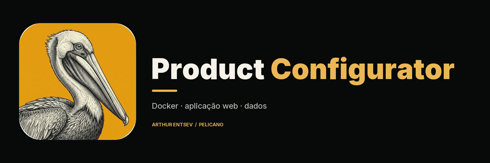</p>

<p align="center">Ambiente em containers para um configurador de produtos com aplicação web e banco de dados.</p>

<p align="center">


</p>


<p align="center"><a href="#visão-geral">Visão geral</a> &nbsp;·&nbsp; <a href="#recursos">Recursos</a> &nbsp;·&nbsp; <a href="#como-executar">Como executar</a></p>


<a id="explore-o-projeto"></a>

<a id="por-onde-começar"></a>

<p>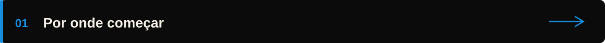</p>


- **[Serviços](docker-compose.yml)** — Configuração dos containers do ambiente.
- **[Imagem](Dockerfile)** — Etapas de construção da imagem.
- **[Aplicação](src/index.php)** — Página PHP executada no ambiente.


<a id="visão-geral"></a>

<a id="sobre-o-projeto"></a>

<p>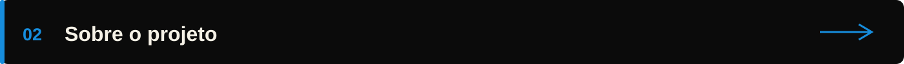</p>

Desenvolvido como projeto prático da certificação **Docker Essentials: A Developer Introduction (IBM)**, o repositório combina um Dockerfile customizado com orquestração via docker-compose.yml, redes internas isoladas e persistência de dados em volumes nomeados.

<a id="recursos"></a>


<p>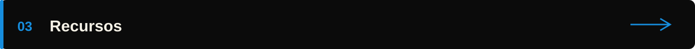</p>

**Orquestração Multi-Container**<br>
docker-compose.yml coordena a inicialização conjunta do servidor Apache/PHP e do banco MySQL.

**Imagem PHP Customizada**<br>
Dockerfile baseado em php:8.2-apache com instalação automática de mysqli, pdo_mysql e ativação do mod_rewrite.

**Persistência com Named Volume**<br>
O volume db_data preserva as tabelas e registros do MySQL mesmo que os contêineres sejam recriados.

**Hot-Reload via Bind Mount**<br>
O mapeamento ./src:/var/www/html reflete edições no código-fonte instantaneamente sem novo build.

**Isolamento em Rede Bridge**<br>
A rede dedicada app-network permite resolução DNS interna pelo hostname db, mantendo o banco seguro.

**Variáveis de Ambiente**<br>
Arquivo .env.example documenta as credenciais de banco desacopladas do código-fonte.

<a id="tecnologias"></a>


<p>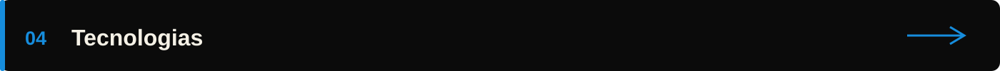</p>

- **Docker Engine & Docker Compose** para construção de imagem, rede e ciclo de vida dos serviços;
- **PHP 8.2 + Apache** com extensões de conectividade relacional pré-compiladas;
- **MySQL** operando em contêiner dedicado com armazenamento persistente.

<a id="arquitetura"></a>

<p></p>


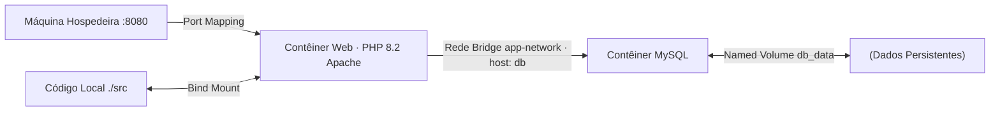

O tráfego externo entra apenas pela porta 8080 mapeada para o Apache, enquanto a comunicação entre aplicação e banco de dados trafega exclusivamente dentro da rede interna app-network.


<a id="certificação"></a>


<p>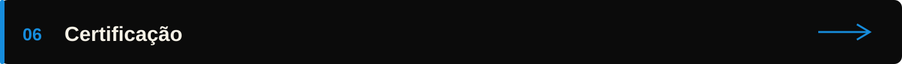</p>

<p align="center">
  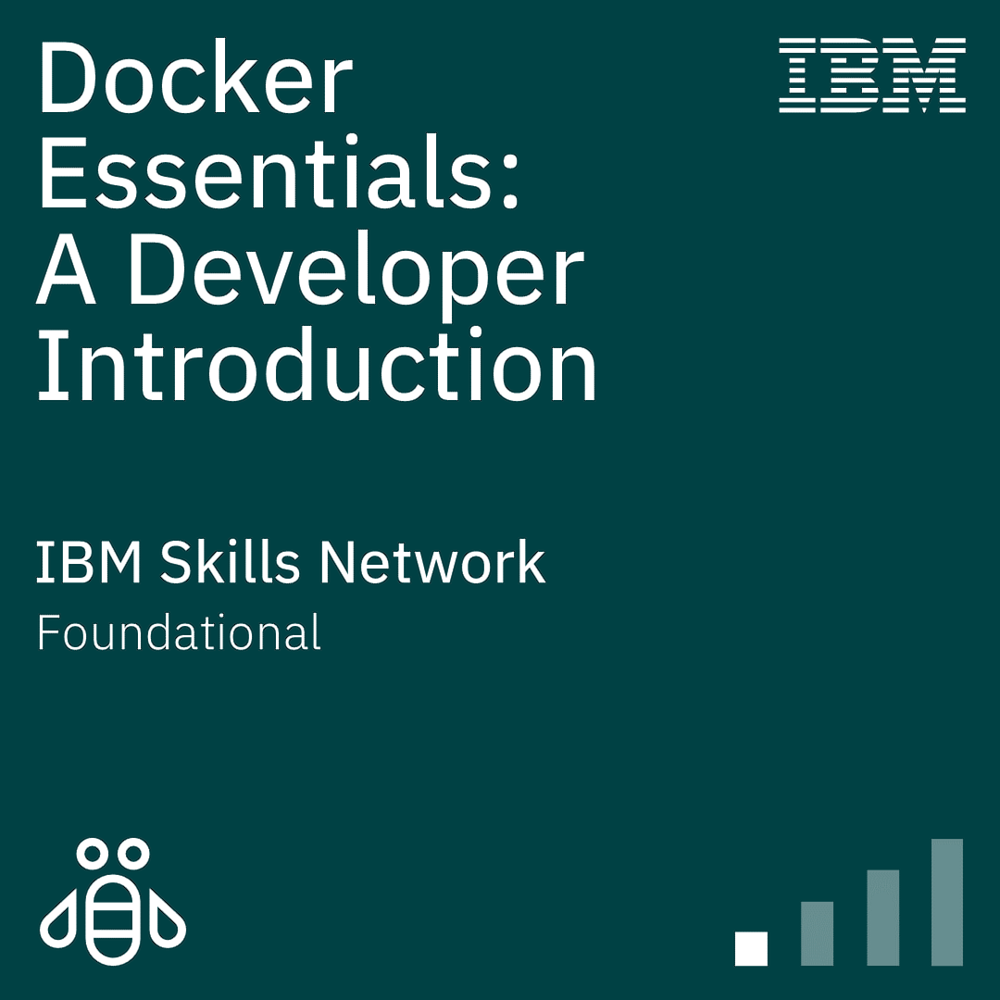
</p>

<a id="estrutura-do-repositório"></a>

<p>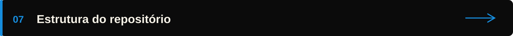</p>


```text
Docker-product-configurator/
├── assets/
│   └── identity/banner.png               Banner do projeto
├── src/
│   ├── index.php                                           Aplicação PHP conectada ao serviço MySQL
│   └── docker-essentials-a-developer-introduction.png      Certificado de conclusão
├── Dockerfile                                              Imagem customizada PHP 8.2 + extensões
├── docker-compose.yml                                      Orquestração de serviços, volumes e rede
├── .env.example                                            Modelo de variáveis de ambiente
└── README.md
```


<a id="como-executar"></a>


<p>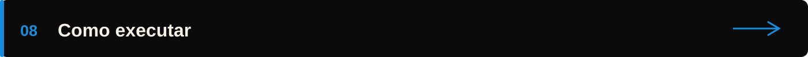</p>

1. Clone o repositório e configure o arquivo .env:
   ```bash
   git clone https://github.com/arthurlynow098/Docker-product-configurator.git
   cd Docker-product-configurator
   cp .env.example .env
   ```
2. Construa e inicie os contêineres em segundo plano:
   ```bash
   docker compose up -d --build
   ```
3. Acesse a aplicação no navegador em http://localhost:8080.

<a id="decisões-técnicas"></a>


<p>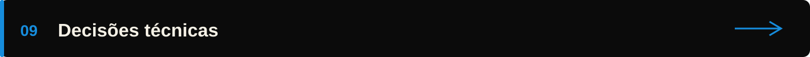</p>

- **Dockerfile próprio em vez de imagem crua:** evita ter que instalar extensões pdo_mysql e mysqli manualmente a cada inicialização do contêiner.
- **DNS interno por nome de serviço:** conectar o PHP ao host db em vez de localhost desacopla a aplicação de endereços IP dinâmicos.


<p align="center">
  <a href="https://github.com/arthurlynow098">GitHub</a> &nbsp;·&nbsp;
  <a href="https://arthurentsev.vercel.app/">Portfólio</a> &nbsp;·&nbsp;
  <a href="https://www.linkedin.com/in/entsevarthur/">LinkedIn</a>
</p>


<a id="identidade-e-créditos"></a>

<p>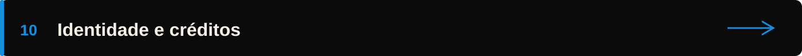</p>

<table><tr><td width="150">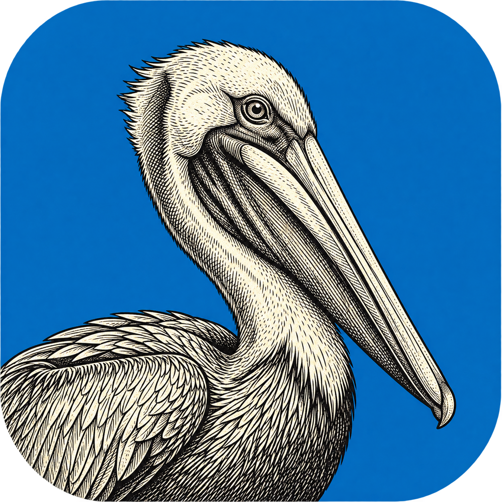</td><td><strong>Pelicano</strong><br>Agrupa e transporta componentes em um conjunto.<br><br><a href="assets/identity-v2/logo.png">Logo em PNG</a> · <a href="assets/identity-v2/banner.png">Banner em PNG</a></td></tr></table>

Artes da coleção fornecida por **Arthur Entsev**, com adaptação das logos e acabamento dos banners realizados com auxílio de geração de imagens. Referências de identidade e apresentação: [LynowCut](https://github.com/arthurlynow098/LynowCut), [LynowMic](https://github.com/arthurlynow098/LynowMic) e [LynowCatch](https://github.com/arthurlynow098/LynowCatch). Os créditos e avisos do conteúdo original foram preservados.

<p align="center"><a href="#top">Voltar ao topo ↑</a> · <a href="https://github.com/arthurlynow098">Arthur Entsev</a> · <a href="https://arthurentsev.vercel.app/">Portfólio</a></p>
