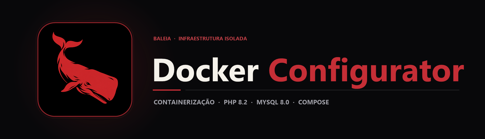

  

  Infraestrutura local padronizada, isolada e reprodutível para aplicações PHP 8.2 e MySQL 8.0 orquestrada com Docker Compose.

  
  
  

## Sobre o projeto

O clássico problema *"na minha máquina funciona"* nasce de diferenças sutis entre versões de interpretadores, extensões ausentes e configurações manuais de banco de dados. Este projeto resolve essa fricção ao empacotar todo o ambiente de uma aplicação web em **PHP 8.2 e MySQL** dentro de contêineres declarativos que sobem com um único comando.

Desenvolvido como projeto prático da certificação **Docker Essentials: A Developer Introduction (IBM)**, o repositório combina um Dockerfile customizado com orquestração via docker-compose.yml, redes internas isoladas e persistência de dados em volumes nomeados.

## Principais recursos

| Recurso | Como funciona |
|---|---|
| Orquestração Multi-Container | docker-compose.yml coordena a inicialização conjunta do servidor Apache/PHP e do banco MySQL. |
| Imagem PHP Customizada | Dockerfile baseado em php:8.2-apache com instalação automática de mysqli, pdo_mysql e ativação do mod_rewrite. |
| Persistência com Named Volume | O volume db_data preserva as tabelas e registros do MySQL mesmo que os contêineres sejam recriados. |
| Hot-Reload via Bind Mount | O mapeamento ./src:/var/www/html reflete edições no código-fonte instantaneamente sem novo build. |
| Isolamento em Rede Bridge | A rede dedicada pp-network permite resolução DNS interna pelo hostname db, mantendo o banco seguro. |
| Variáveis de Ambiente | Arquivo .env.example documenta as credenciais de banco desacopladas do código-fonte. |

## Tecnologias

  
  
  
  
  

- **Docker Engine & Docker Compose** para construção de imagem, rede e ciclo de vida dos serviços;
- **PHP 8.2 + Apache** com extensões de conectividade relacional pré-compiladas;
- **MySQL** operando em contêiner dedicado com armazenamento persistente.

## Arquitetura

`mermaid
flowchart LR
    A[Máquina Hospedeira :8080] -->|Port Mapping| B[Contêiner Web · PHP 8.2 Apache]
    C[Código Local ./src] <-->|Bind Mount| B
    B -->|Rede Bridge app-network · host: db| D[Contêiner MySQL]
    D <-->|Named Volume db_data| E[(Dados Persistentes)]
`

O tráfego externo entra apenas pela porta 8080 mapeada para o Apache, enquanto a comunicação entre aplicação e banco de dados trafega exclusivamente dentro da rede interna pp-network.

## Certificação

  

## Estrutura do repositório

`	ext
Docker-product-configurator/
├── assets/
│   ├── banner.png                                          Banner principal do projeto
│   └── project-animal.png                                  Símbolo da baleia
├── src/
│   ├── index.php                                           Aplicação PHP conectada ao serviço MySQL
│   └── docker-essentials-a-developer-introduction.png      Certificado de conclusão
├── Dockerfile                                              Imagem customizada PHP 8.2 + extensões
├── docker-compose.yml                                      Orquestração de serviços, volumes e rede
├── .env.example                                            Modelo de variáveis de ambiente
└── README.md
`

## Executando o código

1. Clone o repositório e configure o arquivo .env:
   `ash
   git clone https://github.com/arthurlynow098/Docker-product-configurator.git
   cd Docker-product-configurator
   cp .env.example .env
   `
2. Construa e inicie os contêineres em segundo plano:
   `ash
   docker compose up -d --build
   `
3. Acesse a aplicação no navegador em http://localhost:8080.

## Decisões técnicas

- **Dockerfile próprio em vez de imagem crua:** evita ter que instalar extensões pdo_mysql e mysqli manualmente a cada inicialização do contêiner.
- **DNS interno por nome de serviço:** conectar o PHP ao host db em vez de localhost desacopla a aplicação de endereços IP dinâmicos.

---

Estudo · construção · evolução <a href="https://github.com/arthurlynow098">Perfil</a> · <a href="https://arthurentsev.vercel.app/">Portfólio</a> · <a href="https://www.linkedin.com/in/entsevarthur/">LinkedIn</a>

