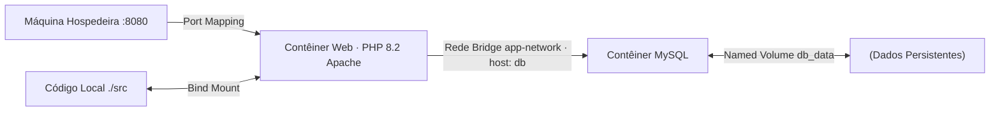
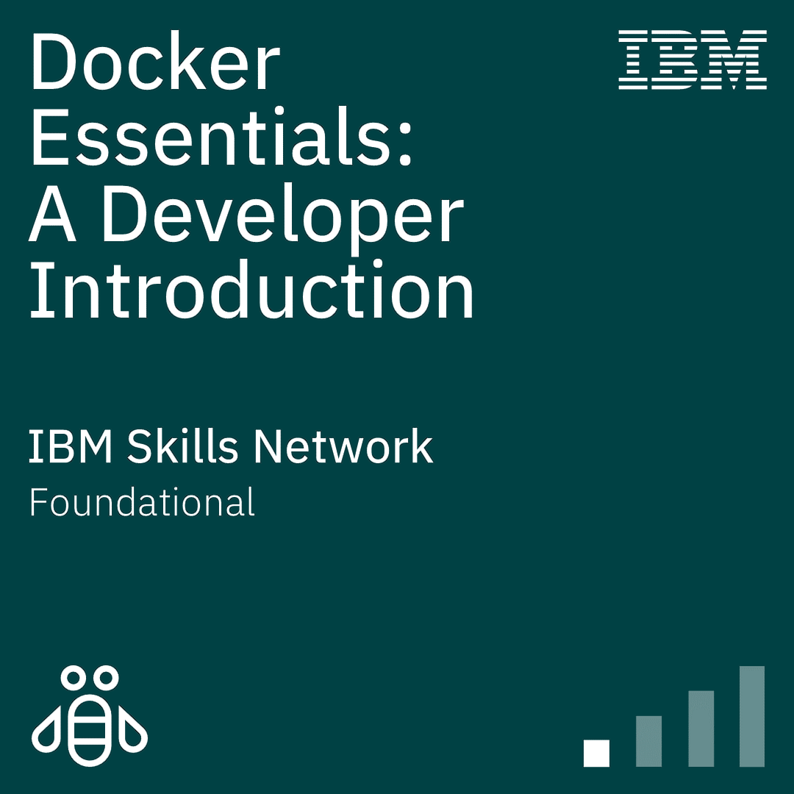

<p align="center">
  
</p>

<p align="center">Ambiente em containers para um configurador de produtos com aplicação web e banco de dados.</p>

<p align="center">
  
  
  
</p>

<p align="center"><a href="#visão-geral">Visão geral</a> &nbsp;·&nbsp; <a href="#recursos">Recursos</a> &nbsp;·&nbsp; <a href="#como-executar">Como executar</a></p>

---

## Visão geral

Desenvolvido como projeto prático da certificação **Docker Essentials: A Developer Introduction (IBM)**, o repositório combina um Dockerfile customizado com orquestração via docker-compose.yml, redes internas isoladas e persistência de dados em volumes nomeados.

## Recursos

| Recurso | Como funciona |
|---|---|
| Orquestração Multi-Container | docker-compose.yml coordena a inicialização conjunta do servidor Apache/PHP e do banco MySQL. |
| Imagem PHP Customizada | Dockerfile baseado em php:8.2-apache com instalação automática de mysqli, pdo_mysql e ativação do mod_rewrite. |
| Persistência com Named Volume | O volume db_data preserva as tabelas e registros do MySQL mesmo que os contêineres sejam recriados. |
| Hot-Reload via Bind Mount | O mapeamento ./src:/var/www/html reflete edições no código-fonte instantaneamente sem novo build. |
| Isolamento em Rede Bridge | A rede dedicada app-network permite resolução DNS interna pelo hostname db, mantendo o banco seguro. |
| Variáveis de Ambiente | Arquivo .env.example documenta as credenciais de banco desacopladas do código-fonte. |

## Tecnologias

- **Docker Engine & Docker Compose** para construção de imagem, rede e ciclo de vida dos serviços;
- **PHP 8.2 + Apache** com extensões de conectividade relacional pré-compiladas;
- **MySQL** operando em contêiner dedicado com armazenamento persistente.

<details>
<summary>Arquitetura</summary>



O tráfego externo entra apenas pela porta 8080 mapeada para o Apache, enquanto a comunicação entre aplicação e banco de dados trafega exclusivamente dentro da rede interna app-network.

</details>

## Certificação

<p align="center">
  
</p>

<details>
<summary>Estrutura do repositório</summary>

```text
Docker-product-configurator/
├── assets/
│   └── project-animal.png          Emblema do projeto
├── src/
│   ├── index.php                                           Aplicação PHP conectada ao serviço MySQL
│   └── docker-essentials-a-developer-introduction.png      Certificado de conclusão
├── Dockerfile                                              Imagem customizada PHP 8.2 + extensões
├── docker-compose.yml                                      Orquestração de serviços, volumes e rede
├── .env.example                                            Modelo de variáveis de ambiente
└── README.md
```

</details>

## Como executar

1. Clone o repositório e configure o arquivo .env:
   ```bash
   git clone https://github.com/arthurlynow098/Docker-product-configurator.git
   cd Docker-product-configurator
   cp .env.example .env
   ```
2. Construa e inicie os contêineres em segundo plano:
   ```bash
   docker compose up -d --build
   ```
3. Acesse a aplicação no navegador em http://localhost:8080.

## Decisões técnicas

- **Dockerfile próprio em vez de imagem crua:** evita ter que instalar extensões pdo_mysql e mysqli manualmente a cada inicialização do contêiner.
- **DNS interno por nome de serviço:** conectar o PHP ao host db em vez de localhost desacopla a aplicação de endereços IP dinâmicos.

---

<p align="center">
  <a href="https://github.com/arthurlynow098">GitHub</a> &nbsp;·&nbsp;
  <a href="https://arthurentsev.vercel.app/">Portfólio</a> &nbsp;·&nbsp;
  <a href="https://www.linkedin.com/in/entsevarthur/">LinkedIn</a>
</p>
